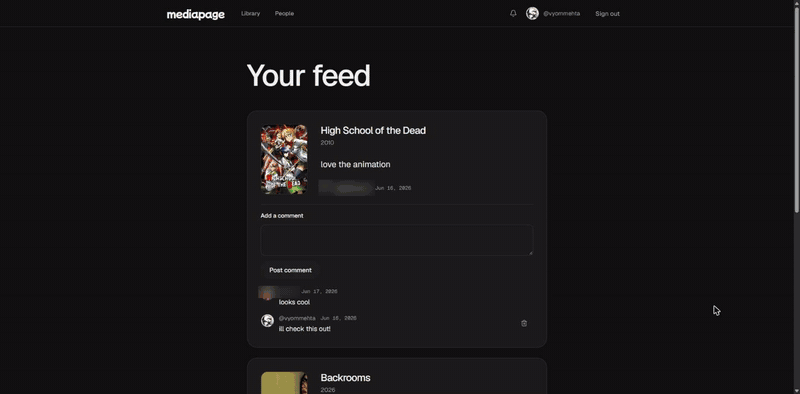

# mediapage



mediapage gives you one public profile with shelves for your favorite movies, shows, music, video games, and books, so people can see your taste in everything on one page.

**Try it:** [mediapage.vercel.app](https://mediapage.vercel.app) · my profile: [/u/vyommehta](https://mediapage.vercel.app/u/vyommehta)

## What you can do

- Fill five shelves (Movies, Shows, Music, Video Games, Books) plus a watchlist. Each shelf holds up to 100 picks, and your top five show on your profile.
- Search every shelf from one place. Shows include TV and anime, Books include manga, and Music is artists.
- Write short recommendations and follow people whose taste you like.
- Keep your profile public, or make it private and approve follow requests.
- Get notified about new followers and follow requests.
- Find other people by handle.

The landing page is a low-poly 3D room you scroll through, one stop per shelf.

## Built with

- [Claude Code](https://claude.com/claude-code)
- Next.js 16 (App Router), React 19, TypeScript, Tailwind CSS v4
- Firebase Auth, Firestore, and Storage (no custom backend; Firestore security rules do the access control)
- three.js with React Three Fiber, using [Kenney](https://kenney.nl) CC0 models
- Motion for animation, TanStack Query for data fetching
- Media data: TMDB (movies and TV), AniList with a Jikan fallback (anime and manga), Deezer (music artists), Open Library (books), and IGDB for games, falling back to Steam search when IGDB keys aren't set
- Vitest and Playwright for tests

## Run it locally

Local dev runs against the Firebase Emulator Suite, so you don't need a real Firebase project.

You need Node 20+ and JDK 21+ (the Firestore emulator requires Java).

```bash
git clone https://github.com/vom00/mediapage.git
cd mediapage
npm install
cp .env.example .env.local
```

To get search results, add a free [TMDB key](https://www.themoviedb.org/settings/api) to `.env.local` as `TMDB_API_KEY`. Music, books, anime, and games (through Steam) work without keys.

Then, in two terminals:

```bash
# Terminal 1: Firebase emulators (auth, firestore, storage)
npx firebase emulators:start --only auth,firestore,storage --project demo-mediapage

# Terminal 2: dev server at http://localhost:3000
npm run dev
```

## Tests

```bash
npm run test    # unit + integration (integration needs the emulators running)
npm run lint
npm run e2e     # Playwright (needs the emulators)
```

## Deploy

The app is server-rendered (dynamic routes plus the `/api/search` route), so it needs a Node host. I use Vercel for the app and Firebase's free Spark plan for auth and data.

1. Publish the security rules and indexes (once, and again whenever they change):

   ```bash
   npx firebase login
   npx firebase deploy --only firestore:rules,firestore:indexes
   ```

   A new Firestore project denies everything until these rules are deployed.

2. Deploy to Vercel with `npx vercel`, add the environment variables below in the Vercel dashboard, then run `npx vercel --prod`.

3. In the Firebase console, add your Vercel domain under Authentication > Settings > Authorized domains. Google sign-in needs this; email and password sign-in works without it.

## Environment variables

See [`.env.example`](.env.example) for the full list.

Client values (`NEXT_PUBLIC_`), from Firebase Project settings > Your apps:

| Variable | Value |
| --- | --- |
| `NEXT_PUBLIC_FIREBASE_API_KEY` | your Firebase web API key |
| `NEXT_PUBLIC_FIREBASE_AUTH_DOMAIN` | `<project-id>.firebaseapp.com` |
| `NEXT_PUBLIC_FIREBASE_PROJECT_ID` | `<project-id>` |
| `NEXT_PUBLIC_FIREBASE_STORAGE_BUCKET` | `<project-id>.firebasestorage.app` |
| `NEXT_PUBLIC_FIREBASE_APP_ID` | your Firebase app ID |

A Firebase web config is public by design: it identifies the project, and the security rules plus Auth control access. Don't set `NEXT_PUBLIC_FIREBASE_EMULATORS` in production.

Server keys (never prefix these with `NEXT_PUBLIC_`):

| Variable | Used for | Get a free key |
| --- | --- | --- |
| `TMDB_API_KEY` | Movie and TV search (required) | [themoviedb.org/settings/api](https://www.themoviedb.org/settings/api) |
| `IGDB_CLIENT_ID` | Game search across every platform (optional) | [dev.twitch.tv/console/apps](https://dev.twitch.tv/console/apps) |
| `IGDB_CLIENT_SECRET` | Game search across every platform (optional) | [dev.twitch.tv/console/apps](https://dev.twitch.tv/console/apps) |

Without the IGDB keys, the games shelf uses Steam's keyless store search, which only covers games sold on Steam.
